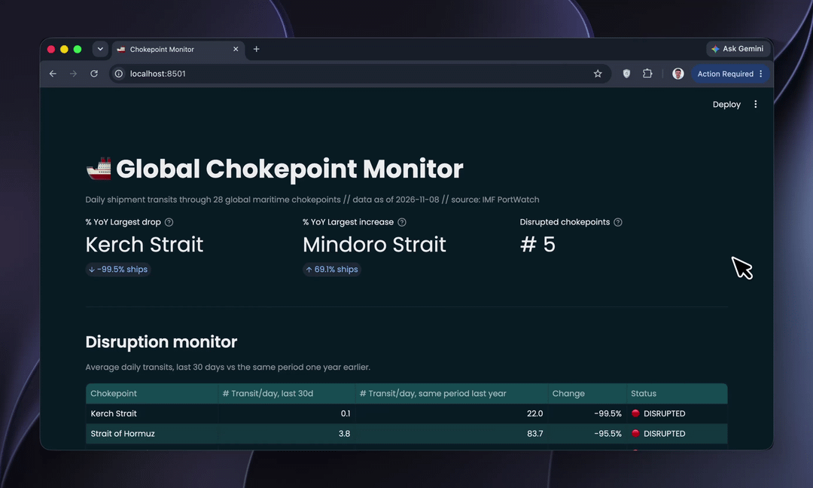
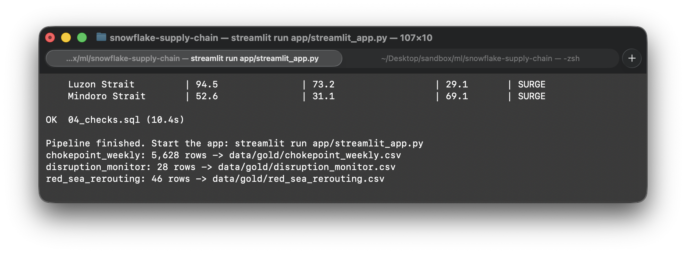
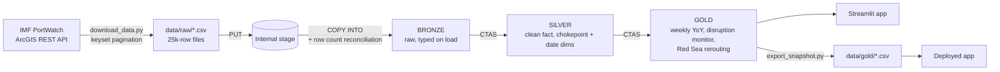

# 🚢 Chokepoint Monitor

**A Snowflake project: a bronze / silver / gold pipeline that turns daily ship-tracking data
from IMF PortWatch into an early-warning view of disruptions at the world's 28 maritime chokepoints.**


[](https://github.com/ceda18/snowflake-supply-chain/actions/workflows/sql-lint.yml)

## The short version

**The problem.** Over 80% of world trade by volume moves by sea, and a big share of it squeezes
through a handful of straits and canals. When one of them is disrupted (conflict, drought, a stuck
ship), voyages get longer, capacity gets tight and prices get higher.

**The solution.** A pipeline that loads daily transits for every chokepoint, compares the last
30 days with the same period last year, and flags anything that dropped or jumped by 25% or more.
A small Streamlit app makes everything go live.

**Why it's interesting.** It's a Snowflake workflow on real, free, daily data, published weekly. I also see a real business use case, because you can make decisions and automations to customers who might face problems on their shipment based on problems in the global logistical chokepoints. 

## Not quite Snowflake

Snowflake doesn't offer self-service trial accounts in Serbia (the country isn't in the sign-up list, and a VPN doesn't change that), so I ran the pipeline on the [LocalStack Snowflake emulator](https://docs.localstack.cloud/snowflake/).

What that means in practice:

- The SQL is Snowflake SQL, and the Python uses the official Snowflake connector and CLI. 
- The emulator is built for testing, not speed, and has quirks.
- No Snowsight UI, Marketplace or Cortex. The app is Streamlit running locally, and the deployed demo reads a snapshot of the gold layer.


> [!IMPORTANT]
> **Try it yourself:** Open the Streamlit deployment and interact with the app live. [LIVE DEMO: chokepoint-monitor.streamlit.app](https://chokepoint-monitor.streamlit.app/).
> (reads a snapshot, data as of 2026-11-08)


## Demo




---



## How I built it

With AI-assisted coding (Claude) as a pair programmer, which is how I like to work on a new stack.
My part: picking the problem and the data source, deciding the scope, running everything against
the emulator, diagnosing the issues found and deciding how to fix each, and checking the
results. The SQL is linted with [SQLFluff](https://sqlfluff.com/) (Snowflake dialect) on every push.

## What the app shows, and why


| Part of the screen | What it answers | Design choice |
|---|---|---|
| **KPI row** | What is the overview right now? | Three numbers: how many chokepoints are disrupted, the biggest drop, the biggest jump. Nothing else above the fold. |
| **Disruption monitor** | Where exactly, and how bad? | All 28 chokepoints sorted from worst to best. Last 30 days vs the **same 30 days last year**, making it more relevant for comparison. |
| **Red Sea rerouting** | What does a disruption look like over time? | One story chart: Red Sea vs the Cape of Good Hope. It shows that traffic doesn't disappear but moves to a longer route. |
| **Chokepoint explorer** | What's the trend for the one I care about? | This week vs the same period last year. |

**Where I'd take it.** A weekly alert to account managers when a chokepoint crosses the threshold (25%), matched to the customers
and that could be affected, with a suggested alternative points (another route, sea-air, rail).

Cortex Analyst: A semantic view so people can ask *"which of my customers ship through Hormuz?"* in plain language.

## Architecture



| Layer | Tables | What happens |
|---|---|---|
| **Bronze** | `chokepoints_daily_raw`, `chokepoints_meta_raw` | Files land in an internal stage and are loaded with `COPY INTO`, typed on load. Row counts are reconciled against the source files; the pipeline stops if they differ. |
| **Silver** | `fct_chokepoint_daily`, `dim_chokepoint`, `dim_date`, `data_bounds` | One row per chokepoint per day (dedup with `qualify row_number()`), port-only columns dropped, a date dimension for week/month, and a one-row table with the comparison windows. |
| **Gold** | `chokepoint_weekly`, `disruption_monitor`, `red_sea_rerouting` | Exactly what the app reads, nothing more. |

## What the data shows

As of **8 November 2026**, last 30 days vs the same 30 days in 2025:

| Chokepoint | Ships / day, 2025 | Ships / day, 2026 | Change |
|---|---|---|---|
| Strait of Hormuz | 83.7 | 3.8 | **−95.5%** |
| Kerch Strait | 22.0 | 0.1 | **−99.5%** |
| Bosporus Strait | 99.3 | 48.0 | **−51.7%** |
| Bab el-Mandeb Strait | 36.8 | 27.2 | **−26.1%** |
| Suez Canal | 41.9 | 43.2 | +3.1% |
| Mindoro Strait | 31.1 | 52.6 | **+69.1%** |

The Red Sea route, monthly average transits:

| | 2023 | 2024 | 2025 | 2026 (Jan–Oct) | 2026 vs 2023 |
|---|---|---|---|---|---|
| Suez Canal | 2,241 | 1,208 | 1,173 | 1,244 | **−44.5%** |
| Bab el-Mandeb Strait | 2,251 | 992 | 1,018 | 1,004 | **−55.4%** |
| Cape of Good Hope | 1,494 | 2,654 | 2,721 | 2,750 | **+84.1%** |

The shift happened in 2024 and has held since. Suez has stayed around 1,200 transits a month for
three years, so a flat year-over-year number isn't a recovery; the comparison that matters is
against the 2023 baseline.

**Why this makes business sense.** For a logistics company, a chokepoint disruption turns into longer
transit times, lower capacity and rate changes on specific routes, usually within weeks. The daily data
here is free, public and updated weekly, and the whole pipeline costs next to nothing to run. That
would make it a cheap early-warning layer. Commercial teams can warn affected customers before they ask,
re-quote with realistic transit times, and offer alternatives.


## Repository structure

```
├── sql/                        # run in this order
│   ├── 00_setup.sql            # warehouse, database, bronze/silver/gold schemas
│   ├── 01_bronze.sql           # stage, put, copy into
│   ├── 02_silver.sql           # fact, dimensions, date windows
│   ├── 03_gold.sql             # tables the app reads
│   └── 04_checks.sql           # data quality checks
├── scripts/
│   ├── download_data.py        # PortWatch API -> data/raw/*.csv
│   ├── run_pipeline.py         # runs sql/*.sql, reconciles bronze row counts
│   └── export_snapshot.py      # gold tables -> data/gold/*.csv
├── app/
│   ├── streamlit_app.py        # the dashboard
│   └── requirements.txt        # app-only dependencies (for deployment)
├── data/gold/                  # snapshot the deployed app reads
├── .github/workflows/          # SQLFluff lint
├── .sqlfluff
├── docker-compose.yml          # LocalStack Snowflake emulator
└── requirements.txt
```

## Run it

**Just the app** (no Docker, no account; reads the snapshot in `data/gold/`):

```bash
pip install streamlit pandas
DATA_SOURCE=snapshot streamlit run app/streamlit_app.py
```

**The full pipeline.** Needs Docker, Python 3.12 and a free [LocalStack](https://app.localstack.cloud)
account for the auth token.

```bash
# 1. environment
uv venv --python 3.12 && source .venv/bin/activate
uv pip install -r requirements.txt

# 2. emulator
cp .env.example .env              # paste your LocalStack token
docker compose up -d

# 3. extract, load, transform (a few minutes on the emulator)
python scripts/download_data.py
python scripts/run_pipeline.py

# 4. app, and optionally refresh the snapshot
streamlit run app/streamlit_app.py
python scripts/export_snapshot.py

# lint
sqlfluff lint sql/
```

---

*Data: [IMF PortWatch](https://portwatch.imf.org/). Built to learn Snowflake by shipping something, literally :).*
